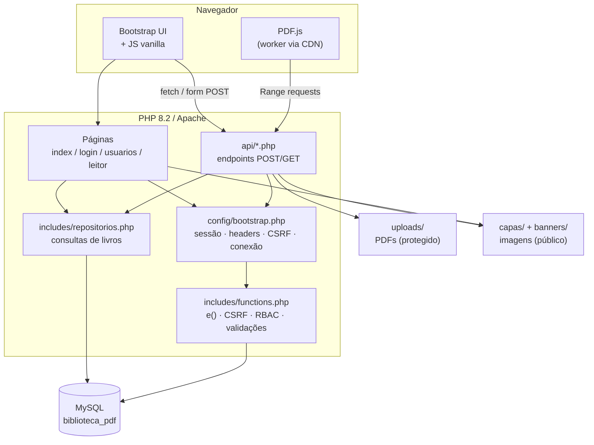
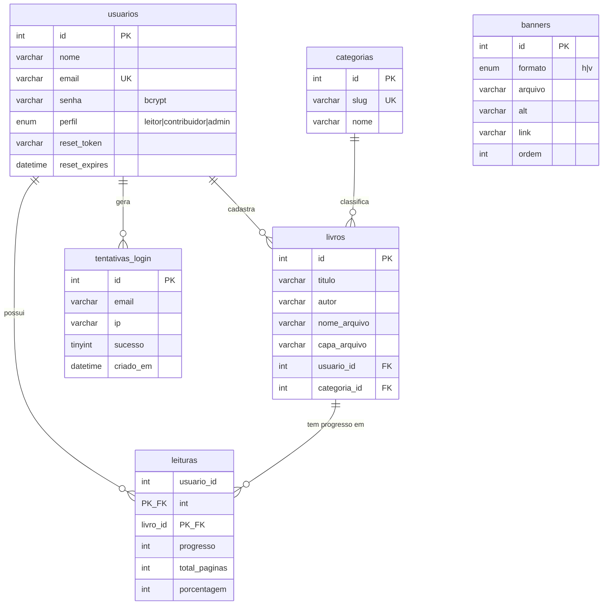

# 📚 Meus Livros

Biblioteca pessoal de PDFs — um web app responsivo para catalogar, ler e acompanhar o progresso de leitura de livros em PDF, com controle de acesso por perfil de usuário.

> Projeto em PHP puro (sem framework), feito para rodar sobre XAMPP ou qualquer Apache + PHP + MySQL. Este README é o guia completo: instalação, configuração do banco, publicação e execução da suíte de testes.

**O repositório contém apenas o código.** Por conterem dados pessoais, ficam de fora (via `.gitignore`) e são criados na sua instalação:

| Fora do repositório | Por quê |
|---|---|
| `.env` | Credenciais do banco — use o `.env.example` como modelo |
| `uploads/*.pdf` | Os PDFs do acervo |
| `capas/*.png` | As capas geradas a partir dos PDFs |
| `banners/*` | As imagens de banner do sistema |
| Usuários e senhas | Nenhum usuário vem no `schema.sql`; o primeiro admin é criado por você (passo 4) |

As pastas `uploads/`, `capas/` e `banners/` vêm versionadas vazias, já com os `.htaccess` que as protegem.

---

## Índice

- [Visão geral](#visão-geral)
- [Funcionalidades](#funcionalidades)
- [Stack tecnológica](#stack-tecnológica)
- [Arquitetura](#arquitetura)
- [Como rodar localmente](#como-rodar-localmente)
- [Importar um acervo em lote](#importar-um-acervo-em-lote)
- [Hospedagem](#hospedagem)
- [Estrutura de pastas](#estrutura-de-pastas)
- [Modelo de dados](#modelo-de-dados)
- [Referência da API](#referência-da-api)
- [Segurança](#segurança)
- [Testes automatizados (Cypress)](#testes-automatizados-cypress)
- [Limitações conhecidas](#limitações-conhecidas)
- [Licença](#licença)

---

## Visão geral

**Meus Livros** resolve um problema simples: uma coleção grande de PDFs espalhados em pastas, sem forma de acompanhar o que já foi lido. O sistema centraliza os arquivos, gera capas automaticamente a partir da primeira página de cada PDF, e oferece um leitor embutido que lembra exatamente onde cada usuário parou — de forma independente por pessoa, já que o acervo pode ser compartilhado entre várias contas com níveis de acesso diferentes.

- **Multiusuário com três perfis**: leitor, contribuidor e administrador, cada um com um conjunto distinto de permissões.
- **100% responsivo**: a mesma interface funciona em desktop, tablet e celular, incluindo o leitor de PDF (com gestos de swipe no mobile).
- **Sem dependência de serviços externos para funcionar**: as únicas chamadas de rede saem para CDNs de bibliotecas front-end (Bootstrap, Font Awesome, PDF.js) — todo o resto roda localmente.

---

## Funcionalidades

| Área | O que faz |
|---|---|
| **Catálogo de livros** | Upload de PDF com geração automática de capa (renderizada no navegador a partir da 1ª página), edição de título/autor, exclusão com limpeza dos arquivos físicos |
| **Busca, categorias e navegação** | Busca em tempo real (server-side, sobre todo o acervo) com debounce e atalho `/`; filtro por **categoria** (chips com contagem); ordenação por mais recentes, mais antigos, A-Z e Z-A; **10 livros por página** com paginação em controle segmentado (estilo iOS) |
| **Continue lendo** | Faixa de atalhos com os livros em andamento (sem barra de rolagem, arrasto com o mouse), com progresso e retomada na página certa |
| **Leitor de PDF integrado** | PDF.js com texto nítido em telas retina; barra superior (voltar, título, progresso) e doca de controles que somem sozinhas; zoom (0.4×–3.0×) e pinça no toque; toque nas bordas vira a página; atalhos de teclado (← →, + −, 0, F); tela cheia; carregamento em streaming (HTTP Range) para arquivos grandes; layouts para desktop, tablet e celular |
| **Leitor de EPUB** | Livros em EPUB entram pelo mesmo "Novo livro" (título, autor e capa são lidos do próprio arquivo) ou em lote por `php database/importar_epubs.php`. Leitor próprio com [epub.js](https://github.com/futurepress/epub.js) 0.3: o texto reflui conforme a tela, tamanho da letra e tema (escuro, sépia, claro) à escolha, sumário, retomada exata de onde parou e progresso em %. Marca-texto e anotações ainda são só do PDF. Aplique `database/migracao_v1.15_epub.sql` em bancos antigos |
| **Progresso de leitura por usuário** | Cada usuário tem seu próprio marcador de página em cada livro — dois leitores do mesmo PDF não sobrescrevem o progresso um do outro |
| **Autenticação e controle de acesso** | Login com hash bcrypt, três perfis de RBAC, recuperação de senha por token de uso único, troca de senha autenticada |
| **Gestão de usuários** (admin) | Modal no painel (sem trocar de página): criar, listar e remover usuários; redefinir senha de terceiros; proteção contra auto-exclusão |
| **Anúncio em banner quadrado** (admin gerencia) | Abre sobre a tela ao entrar no sistema, ao abrir um livro e ao sair dele, sempre com botão de fechar. Aparece para o **Administrador** (para ver como fica) e para o plano **Grátis**; o plano **Pro** não vê anúncios. O admin adiciona, remove, reordena e define um **link por banner** (abre em nova aba). Já vem com peças de venda (Meus Livros Pro, Topete Game Retrô, livro e MALU) |
| **Planos** | **Grátis** (com anúncios, 1 acesso), **Pro** (sem anúncios, até 3 acessos com o titular e dependentes) e **Administrador**. Internamente: `leitor` = Grátis, `contribuidor` = Pro |
| **Foto de perfil** | No menu do usuário: envia, troca ou remove a foto (JPG, JPEG ou PNG, até 2 MB). O servidor corta em quadrado e reduz para 256 px em WebP (~20 KB), então o disco e o banco não enchem; no banco fica só o nome do arquivo |
| **Tema** | Botão na barra superior: **Escuro** (padrão), **Claro** ou **Papel**; lembrado no navegador e usado também no leitor de EPUB |
| **Login que dura** | A sessão só termina no **Sair** ou após **4 horas sem ação**; quem lê um livro longo não é deslogado (a página avisa o servidor a cada 5 min enquanto há atividade) |
| **Integração com o sistema operacional** | Cor de tema no Chrome do Android e no Safari do iOS 15+ (a barra de endereços assume o tom do fundo), `color-scheme` escuro para controles nativos, e metas de aplicativo para quando o site é salvo na tela de início |
| **Acervo grande** | Importador em lote por linha de comando (centenas ou milhares de PDFs): deduplica por conteúdo, repara nomes corrompidos, gera capas e nunca grava sem `--aplicar`. Paginação numerada (`1 … 4 [5] 6 … 71`) e gerenciador paginado no servidor |
| **Aplicativo instalável (PWA)** | Manifesto, ícones (inclusive *maskable*) e cor de tema: dá para instalar na tela inicial do Android e do iPhone e abrir sem a moldura do navegador |
| **Segurança de aplicação web** | CSRF em todas as ações de escrita, XSS mitigado por escaping consistente, rate limiting de login, validação de upload por assinatura real de arquivo (não só extensão), CSP, cookies de sessão endurecidos |

---

## Stack tecnológica

| Camada | Tecnologia |
|---|---|
| Backend | PHP 8.2 (procedural, sem framework — PDO para acesso a dados) |
| Banco de dados | MySQL / MariaDB |
| Frontend | Bootstrap 5.3, Font Awesome 6, JavaScript vanilla (sem build step) |
| Renderização de PDF | [PDF.js](https://mozilla.github.io/pdf.js/) 2.16 |
| Servidor local | Apache (via XAMPP) |

Não há dependências de build (webpack/vite/npm) — o front-end é servido como está, sem etapa de compilação. O único gerenciamento de dependências é via CDN (ver [Segurança](#segurança) sobre a Content-Security-Policy que restringe quais CDNs são permitidos).

---

## Arquitetura



### Decisões de arquitetura

- **Sem framework, com convenções próprias.** O projeto é PHP procedural organizado por convenção: um bootstrap único (`config/bootstrap.php`) resolve sessão, headers de segurança, CSRF e conexão de banco para toda página/endpoint, evitando a duplicação de lógica de autenticação que existiria sem ele.
- **PDFs nunca ficam publicamente acessíveis.** A pasta `uploads/` é bloqueada por `.htaccess`; todo PDF é servido por `api/download.php`, que exige sessão autenticada e implementa HTTP Range requests para permitir streaming (importante para arquivos grandes).
- **Capas e banners são conteúdo público de baixa sensibilidade** e ficam em pastas servidas diretamente pelo Apache (`capas/`, `banners/`), com execução de PHP desabilitada nelas por precaução.
- **Busca no servidor, não no DOM.** A busca consulta o banco (`LIKE`) e devolve HTML pronto via AJAX — versões anteriores filtravam apenas os itens já renderizados na tela, o que limitava a busca à página atual.

---

## Como rodar localmente

### Pré-requisitos

- [XAMPP](https://www.apachefriends.org/) (ou Apache + PHP 8.2+ + MySQL/MariaDB avulsos)
- Extensões PHP: `pdo_mysql`, `fileinfo`, `mbstring`, `openssl` (todas vêm habilitadas por padrão no XAMPP)
- Apache com `mod_rewrite` e `AllowOverride All` — necessário para as URLs amigáveis e para a proteção dos arquivos por `.htaccess` (padrão no XAMPP e na maioria das hospedagens)
- [Node.js](https://nodejs.org/) 22.13+ — **apenas** para os testes e as ferramentas (importador de acervo, ícones); a aplicação em si não precisa dele

### Passo a passo

1. **Clone o repositório** dentro da pasta `htdocs` do XAMPP (ou na raiz web do seu servidor):
   ```bash
   git clone https://github.com/ariceliomouradev/ebook-v2.git meus_livros
   cd meus_livros
   ```
   O nome da pasta define a URL da aplicação (`http://localhost/meus_livros/`) e é
   usado no passo 3 — se você usar outro nome, ajuste `APP_URL` de acordo.

2. **Crie o banco de dados** e aplique o schema (cria todas as tabelas e já cadastra as categorias e os banners padrão; pode ser reaplicado sem perder dados):
   ```bash
   mysql -u root -e "CREATE DATABASE biblioteca_pdf CHARACTER SET utf8mb4 COLLATE utf8mb4_general_ci;"
   mysql -u root biblioteca_pdf < database/schema.sql
   ```

3. **Configure as variáveis de ambiente** copiando o modelo:
   ```bash
   cp .env.example .env
   ```
   Edite `.env` com as credenciais do seu MySQL e a URL da instalação:
   ```ini
   DB_HOST=localhost
   DB_NAME=biblioteca_pdf
   DB_USER=root
   DB_PASS=
   DB_CHARSET=utf8mb4

   APP_ENV=local
   APP_DEBUG=true

   APP_URL=http://localhost/meus_livros/
   ```

4. **Crie o primeiro usuário administrador** — não há tela de "primeiro acesso".
   O utilitário abaixo aplica o hash bcrypt e monta o SQL pronto:
   ```bash
   php database/criar_admin.php
   ```
   Ele pergunta nome, e-mail, senha e perfil, valida a política de senha e imprime o
   `INSERT` para colar no phpMyAdmin. Com `--inserir`, grava direto no banco do `.env`:
   ```bash
   php database/criar_admin.php "Seu Nome" "voce@exemplo.com" "SuaSenha@123" admin --inserir
   ```
   O script só roda por linha de comando (a pasta `database/` é bloqueada na web) e a
   senha não é gravada em lugar nenhum — sai dali apenas o hash.

5. **Garanta que o PHP pode escrever** em `uploads/`, `capas/` e `banners/` — é onde
   os PDFs, as capas geradas e os banners são gravados. No Windows/XAMPP isso já
   funciona por padrão; em Linux:
   ```bash
   sudo chown -R www-data:www-data uploads capas banners
   sudo chmod -R 775 uploads capas banners
   ```

6. **Confirme que o Apache lê os `.htaccess`** do projeto (eles bloqueiam o acesso
   direto aos PDFs, ao `.env` e às pastas de código). É preciso ter o
   `mod_rewrite`/`AllowOverride All` habilitado — no XAMPP já vem assim. Para testar,
   abra `http://localhost/meus_livros/.env`: a resposta correta é **403 Forbidden**.
   Se `/login` der 404 mas `/login.php` abrir, é sinal de que o `mod_rewrite` está
   desativado — as URLs amigáveis dependem dele.

7. **Acesse pelo navegador** e entre com o usuário criado no passo 4:
   ```
   http://localhost/meus_livros/login.php
   ```

### Variáveis de ambiente

| Variável | Descrição | Padrão |
|---|---|---|
| `DB_HOST` | Host do MySQL | `localhost` |
| `DB_NAME` | Nome do banco | `biblioteca_pdf` |
| `DB_USER` | Usuário do banco | `root` |
| `DB_PASS` | Senha do banco | *(vazia)* |
| `DB_CHARSET` | Charset da conexão | `utf8mb4` |
| `APP_ENV` | Ambiente (`local`, `production`) | `local` |
| `APP_DEBUG` | Exibe erros PHP na tela quando `true` — **deixe `false` fora de ambiente local** | `true` |
| `APP_URL` | URL onde a aplicação responde; usada pela suíte Cypress como `baseUrl` | `http://localhost/meus_livros/` |

> ⚠️ `.env` nunca deve ser commitado — está no `.gitignore`. Um usuário MySQL dedicado (não `root`) com privilégios mínimos é recomendado fora de ambiente de desenvolvimento.

---

## Importar um acervo em lote

Para cadastrar uma coleção grande de PDFs de uma vez (o sistema foi exercitado com 1.400 livros / 5 GB):

```bash
npm install
npm run acervo -- --origem "D:\Livros"            # SIMULAÇÃO: analisa tudo e não grava nada
npm run acervo -- --origem "D:\Livros" --aplicar  # importa de verdade
npm run acervo -- --desfazer                      # remove exatamente o que o importador gravou
```

**O que ele faz**

1. **Deduplica por conteúdo** (SHA-256), não pelo nome: o mesmo livro com nomes diferentes entra uma vez só. Também ignora o que já está em `uploads/`.
2. **Repara nomes corrompidos** (`Educa+º+úo` → `Educação`), um defeito comum de ZIPs extraídos com a página de código errada.
3. **Valida cada PDF** com o PDF.js: arquivo truncado, protegido por senha, que não é PDF ou com menos de 5 páginas vai para a lista de rejeitados em vez de entrar na biblioteca.
4. **Gera a capa** da primeira página (o mesmo PDF.js do navegador, então ela fica igual à do upload normal).
5. **Infere título e autor** do nome do arquivo (`Título - Autor`, `Autor - Título`, `Título by Autor`), usando o próprio acervo para reconhecer autores que se repetem. **Sem evidência, o autor fica "Autor Desconhecido"**: um autor errado é pior que nenhum, e o nome completo do arquivo continua no título.

**Segurança**

- Os PDFs de origem são **copiados**: a pasta de origem nunca é alterada.
- Sem `--aplicar` nada é gravado (só o relatório).
- É retomável: se for interrompido, rode de novo e ele continua de onde parou.
- Recusa rodar com `APP_ENV=production`.
- Tem trava contra duas execuções simultâneas.

**Relatório para conferir**: `database/.importacao/relatorio.csv` (abre no Excel) traz uma linha por arquivo da origem, com status (`importado`, `duplicado`, `rejeitado`...), título, autor, a confiança da inferência e o motivo de cada rejeição. A pasta é ignorada pelo git e bloqueada no Apache.

Opções: `--limite N` (testar com poucos), `--concorrencia N`, `--min-paginas N`, `--tempo-max S`, `--dono e-mail`. Veja `npm run acervo -- --ajuda`.

> Com milhares de livros, lembre que a hospedagem compartilhada costuma ter limite de espaço em disco e de tamanho de upload. Confira o plano antes de enviar o acervo.

---
## Hospedagem

O projeto roda em qualquer hospedagem com Apache + PHP 8.2 + MySQL (compartilhada
ou VPS). Não há etapa de build: envie os arquivos, crie o banco e configure o `.env`.

1. Coloque os arquivos na pasta pública do domínio (`public_html` ou a pasta do
   subdomínio). Duas formas:
   - **Deploy por Git** (recomendado quando o painel oferece, como o hPanel da
     Hostinger ou o cPanel): aponte para este repositório e para a pasta do
     domínio. Atualizar depois é um clique — não há build para rodar.
   - **FTP/SFTP ou gerenciador de arquivos**: envie tudo, **menos** `node_modules/`
     (não é usado em produção) e, se quiser, `cypress/`.

   `node_modules/` nunca deve ir para o servidor. As pastas `cypress/` e `scripts/` são inofensivas
   (só ferramentas de desenvolvimento, e já vêm bloqueadas por `.htaccess`), então podem ficar.
2. Crie o banco pelo painel da hospedagem (ou phpMyAdmin) e importe `database/schema.sql`: ele cria **todas** as tabelas e já cadastra as categorias e os banners padrão (as imagens estão em `assets/promo/`, versionadas no repositório). Pode ser importado de novo sem apagar nada.
3. Crie o `.env` **direto no servidor** — ele nunca vem no repositório. Copie o
   conteúdo do `.env.example` pelo gerenciador de arquivos e preencha com o usuário
   de banco da hospedagem e:
   ```ini
   APP_ENV=production
   APP_DEBUG=false
   APP_URL=https://seu-dominio.com/
   ```
4. Crie o primeiro admin: rode `php database/criar_admin.php` **na sua máquina** e
   cole o `INSERT` que ele imprime no phpMyAdmin da hospedagem. Assim a senha nunca
   trafega — só o hash.
5. Confira que os `.htaccess` estão sendo aplicados (`AllowOverride All`): acessar
   `https://seu-dominio.com/.env` precisa devolver **403**, um PDF em
   `https://seu-dominio.com/uploads/arquivo.pdf` também, e `https://seu-dominio.com/login`
   precisa abrir a tela de login (se só `/login.php` funcionar, falta `mod_rewrite`).

**Atualizando uma instalação que já está no ar** (banco criado antes desta versão): não reimporte o schema. No phpMyAdmin, execute em ordem apenas as migrações que faltam: [`v1.2_categorias`](database/migracao_v1.2_categorias.sql), [`v1.3_banners`](database/migracao_v1.3_banners.sql) (banners, já com as peças padrão), [`v1.4_visibilidade`](database/migracao_v1.4_visibilidade.sql) (quem vê cada livro e data de liberação), [`v1.5_perfis`](database/migracao_v1.5_perfis.sql) (perfis Pro/Grátis, aprovação, acessos simultâneos) e [`v1.6_cadastro`](database/migracao_v1.6_cadastro.sql) (WhatsApp no cadastro) , [`v1.7_troca`](database/migracao_v1.7_troca.sql) (troca 1 por 1 do Grátis) e [`v1.8_anotacoes`](database/migracao_v1.8_anotacoes.sql) e [`v1.9_anotacoes_texto`](database/migracao_v1.9_anotacoes_texto.sql) (marca-texto e comentários no leitor, privados por usuário) e [`v1.10_duplicados`](database/migracao_v1.10_duplicados.sql) (esconde livros repetidos de Pro e Grátis). e [`v1.11_favoritos`](database/migracao_v1.11_favoritos.sql) (coração de favoritos). e [`v1.12_assinatura`](database/migracao_v1.12_assinatura.sql) (teste grátis de 30 dias e mensalidade), [`v1.16_banner_quadrado`](database/migracao_v1.16_banner_quadrado.sql) e [`v1.17_banners_venda`](database/migracao_v1.17_banners_venda.sql) (anúncio em banner quadrado, com as peças de venda). Depois da v1.10 rode `php database/analisar_duplicados.php --aplicar` para marcar os repetidos já cadastrados. Depois, classifique os livros já cadastrados:
```bash
php database/categorizar_acervo.php            # simulação: mostra a distribuição
php database/categorizar_acervo.php --aplicar  # grava (só livros sem categoria)
```
Sem acesso a terminal na hospedagem, rode o comando na sua máquina apontando o `.env` para o banco da hospedagem, ou escolha a categoria pelo editar livro.
O PHP precisa poder escrever em `banners/` (imagens enviadas no gerenciador de banners são convertidas para WebP e gravadas lá).

Depois da migração v1.5, rode uma vez `php database/preencher_hash.php` (calcula a "impressão digital" de cada PDF para barrar duplicados; demora em acervos grandes). A mesma ferramenta, com `--listar`, mostra os arquivos idênticos.

### Troca 1 por 1 do Grátis (opcional, desligada por padrão)

Com `ASSINANTE_TROCA=true` no `.env`, o Grátis deixa de ver o acervo inteiro: lê os livros que **enviou** e os que **escolheu** em *Explorar acervo*. Ele começa com `ASSINANTE_LIVROS_INICIAIS` vagas (padrão 3) e ganha **+1 vaga a cada livro dele aprovado** pelo administrador. Desligada, o Grátis continua vendo tudo o que foi liberado para o perfil dele.

> Ao ligar, os usuários Grátis que já existem passam a ver só o que escolherem: avise-os antes e considere dar vagas iniciais suficientes.

### Teste grátis e mensalidade

Quem se cadastra ganha **30 dias grátis**, sem cartão. Depois, o **Pro custa R$ 25/mês** e o **Grátis não é cobrado, mas tem anúncios** (valores em `config/app.php`, `PRECOS_MENSAIS`). O pagamento é por **PIX, combinado direto com o suporte pelo WhatsApp**: defina `SUPORTE_WHATSAPP` no `.env` (só dígitos, com 55). Ao receber, clique em **+30 dias** na linha da pessoa em *Gerenciar usuários*. Contas antigas e administradores não vencem. Por padrão o sistema só avisa; com `ASSINATURA_EXIGIDA=true` quem terminou o teste só vê a tela `/assinatura`.

### Cadastro público (e-mail, senha e WhatsApp)

A tela de entrada tem o link **Cadastre-se** (rota `/cadastro`). Quem se cadastra informa nome, e-mail, WhatsApp (com DDD) e senha forte, vira **Grátis** e já entra. O número é guardado só com dígitos e DDI (ex.: `5585986020364`) e o administrador o vê, com link para o WhatsApp, em *Gerenciar usuários*.

- Proteções: CSRF, campo-isca contra robôs e limite de **5 cadastros por IP por hora**. O e-mail não é confirmado por mensagem (a hospedagem compartilhada costuma não enviar e-mail); confirme pelo WhatsApp se precisar.
- `CADASTRO_ABERTO=false` no `.env` fecha o cadastro (some o link e só o administrador cria contas).

**Recomendações para produção:**

- Use **HTTPS**. Com TLS ativo o cookie de sessão passa a ser marcado como `Secure`
  automaticamente (`config/bootstrap.php`).
- Crie um usuário MySQL dedicado com privilégios mínimos (`SELECT`, `INSERT`,
  `UPDATE`, `DELETE` no banco da aplicação) — não use `root`.
- Ajuste `upload_max_filesize` e `post_max_size` no PHP para o tamanho máximo de PDF
  desejado (o limite da aplicação é 100 MB, definido em `config/app.php`).
- A recuperação de senha usa a função `mail()` do PHP. Em hospedagem sem SMTP
  configurado o envio falha e o link é gravado no log de erro do PHP — configure um
  SMTP se o fluxo de "esqueci minha senha" for necessário.
- Faça backup de `uploads/`, `capas/` e do banco: são os dados que não estão no
  repositório.

---

## Estrutura de pastas

```
meus_livros/
├── api/            # Endpoints (auth, livros, usuários, senha, banners, categorias, download, progresso)
├── assets/         # CSS, JavaScript, fonte Inter, ícones do app e peças de divulgação (promo/) — sem build step
├── banners/        # Imagens de banner (público, sem execução de PHP)
├── capas/          # Capas de livros geradas no upload (público, sem execução de PHP)
├── components/     # Partials PHP incluídos pelas páginas (acesso direto bloqueado)
├── config/         # Bootstrap, conexão de banco, variáveis de ambiente (acesso direto bloqueado)
├── database/       # schema.sql, migrações, criar_admin.php e seed_dev.php (acesso direto bloqueado)
├── includes/       # Funções compartilhadas: escaping, CSRF, RBAC, repositórios de dados (acesso direto bloqueado)
├── scripts/        # Ferramentas Node: importar-acervo, gerar-icones, iniciar-servidor (não vão para produção)
├── cypress/        # Suíte de testes E2E (specs, comandos, fixtures) — não vai para produção
├── uploads/        # PDFs (acesso direto bloqueado — servidos só via api/download.php)
├── views/          # Leitor de PDF
├── .env.example    # Modelo de configuração
├── cypress.config.js  # Configuração do Cypress e tasks de banco dos testes
├── package.json    # Dependências de desenvolvimento (Cypress, driver MySQL, PDF.js e canvas para o importador)
├── manifest.webmanifest  # Manifesto do aplicativo instalável (PWA)
├── CLAUDE.md       # Guia de arquitetura e convenções para agentes de código
├── index.php       # Dashboard principal
├── login.php
├── logout.php
├── redefinir_senha.php
└── usuarios.php    # Redireciona para o painel (a gestão de usuários agora é um modal)
```

Cada pasta de código (`config/`, `includes/`, `database/`, `components/`) tem um
`.htaccess` que bloqueia acesso direto pelo navegador — o conteúdo delas só é
alcançado via `include` do PHP.

---

## Modelo de dados



Schema completo, com todas as colunas, chaves, constraints e dados iniciais, em
[`database/schema.sql`](database/schema.sql). Para bancos criados em versões anteriores, aplique só as migrações que faltam:
[`migracao_v1.1.sql`](database/migracao_v1.1.sql) (progresso por usuário),
[`migracao_v1.2_categorias.sql`](database/migracao_v1.2_categorias.sql) e
[`migracao_v1.3_banners.sql`](database/migracao_v1.3_banners.sql).

---

## Rotas

As páginas são arquivos `.php` no disco, mas o endereço público não tem extensão —
a tradução é feita pelo `.htaccess` da raiz, e o PHP monta os links pela função
`url()` de [`includes/functions.php`](includes/functions.php).

| Endereço | Arquivo | Quem acessa |
|---|---|---|
| `/` | `index.php` | autenticado |
| `/login` | `login.php` | público |
| `/logout` | `logout.php` | autenticado |
| `/usuarios` | `usuarios.php` | admin (só redireciona para o painel com o modal de usuários aberto) |
| `/leitor?id=N` | `views/leitor.php` | autenticado |
| `/redefinir-senha?token=…` | `redefinir_senha.php` | público (com token válido) |

Endereços antigos com `.php` continuam funcionando: respondem **301** para a versão
limpa, então links já compartilhados — inclusive e-mails de redefinição de senha
enviados antes da mudança — não quebram.

Os endpoints de `api/` mantêm a extensão de propósito: são alvos de formulário e de
`fetch`, não aparecem na barra de endereços, e reescrevê-los só criaria risco de
quebrar um POST.

---

## Referência da API

Todos os endpoints exigem sessão autenticada (exceto login e recuperação de senha) e token CSRF em toda requisição de escrita — enviado como campo `csrf_token` em formulários ou header `X-CSRF-Token` em chamadas `fetch`.

| Endpoint | Método | Perfil mínimo | Descrição |
|---|---|---|---|
| `POST /api/auth.php` | POST | público | Login (com rate limiting) |
| `POST /api/upload.php` | POST | contribuidor | Cadastra um novo livro |
| `POST /api/editar.php` | POST | admin | Edita título, autor e categoria de um livro |
| `POST /api/excluir.php` | POST | admin | Remove um livro e seus arquivos |
| `GET /api/download.php?id=` | GET | leitor | Entrega o PDF (com suporte a `Range`) |
| `GET /api/buscar.php` | GET | leitor | Busca/pagina livros via AJAX (parâmetros `busca`, `ordem`, `pagina`, `categoria`) |
| `GET /api/gerenciar_lista.php` | GET | admin | Uma página da lista do modal Gerenciar livros |
| `POST /api/progresso.php?id=` | POST | leitor | Salva o progresso de leitura do usuário atual |
| `POST /api/manage_banners.php` | POST | admin | Banners do carrossel: `adicionar`, `remover`, `mover`, `salvar_link`, `listar` (devolve o HTML atualizado do gerenciador) |
| `POST /api/mudar_senha.php` | POST | leitor | Troca a própria senha |
| `POST /api/solicitar_reset.php` | POST | público | Solicita link de redefinição de senha |
| `POST /api/salvar_nova_senha.php` | POST | público (token) | Confirma nova senha via token |
| `POST /api/usuarios_gerenciar.php` | POST | admin | Usuários do modal: `listar`, `adicionar`, `redefinir_senha`, `excluir` (devolve o HTML atualizado da tabela) |

Endpoints que respondem a chamadas `fetch` devolvem JSON (`{ success, ... }`) com o
status HTTP correspondente — `400` para CSRF inválido, `403` para perfil sem
permissão, `422` para dados inválidos. Endpoints acionados por formulário redirecionam
para a página de origem com um parâmetro `msg=` que dispara o modal de feedback.
O contrato de cada um está coberto pelos testes em `cypress/e2e/`.

---

## Segurança

Práticas aplicadas em toda a base de código:

- **CSRF** — token de sessão validado em toda ação de escrita.
- **XSS** — toda saída passa por escaping (`htmlspecialchars`); nenhuma interatividade depende de atributos `onclick` inline, o que permite uma Content-Security-Policy restritiva (definida em `config/bootstrap.php`, sem `'unsafe-inline'` em `script-src`).
- **Autenticação** — senhas com `password_hash`/`password_verify` (bcrypt), regeneração de ID de sessão no login e após troca de senha, cookies `HttpOnly` + `SameSite`, timeout de inatividade.
- **Upload** — arquivos validados pela assinatura real (magic number / MIME via `finfo`), não apenas pela extensão.
- **Rate limiting** — tentativas de login malsucedidas são limitadas por e-mail e IP.
- **Anti-enumeração** — a recuperação de senha responde de forma idêntica exista ou não o e-mail cadastrado.
- **Superfície de arquivos** — PDFs nunca são servidos diretamente; pastas de configuração e código de suporte (`config/`, `includes/`, `database/`, `components/`) são bloqueadas por `.htaccess`.

Se você encontrar uma vulnerabilidade, por favor não abra uma issue pública: entre em
contato em privado pelo perfil do GitHub do autor.

---

## Testes automatizados (Cypress)

O repositório inclui uma suíte de regressão ponta a ponta com **259 testes** (mais 56 testes unitários do importador) cobrindo
os fluxos dos três perfis, o controle de acesso, a experiência de uso e a
responsividade. A interface é instrumentada com mais de 170 atributos `data-testid`, então os
testes não dependem de classes CSS nem da estrutura do HTML.

### Como rodar

```bash
npm install          # Cypress + driver MySQL (só para desenvolvimento)
npm run fixtures     # gera os arquivos de teste (PDF de 3 páginas, PNGs, TXT inválido)
npm run test:e2e     # roda a suíte inteira em modo headless (~9 min)
```

| Comando | O que faz |
|---|---|
| `npm run test:e2e` | Suíte completa, headless |
| `npm run test:unit` | Testes unitários do importador (segundos, sem navegador nem banco) |
| `npm run test:e2e:open` | Abre a interface gráfica do Cypress |
| `npm run test:auth` | Só autenticação |
| `npm run test:rbac` | Só controle de acesso |
| `npm run test:responsivo` | Só responsividade |
| `npm run test:limpar` | Apaga toda a massa de teste do banco |
| `npm run servidor` | Windows + XAMPP: sobe Apache e MySQL (se parados) e abre o sistema |
| `npm run icones` | Regenera os ícones do aplicativo em `assets/icons/` |

A URL usada nos testes vem do `APP_URL` do `.env` — não é preciso editar
`cypress.config.js`. As credenciais do banco também são lidas de lá.

### Cobertura

| Spec | Testes | O que cobre |
|---|:---:|---|
| `01-autenticacao` | 21 | Login dos três perfis, mensagens genéricas de erro (sem enumeração de contas), CSRF, rate limiting, proteção de rota, logout, cabeçalhos de segurança |
| `02-rbac` | 51 | Matriz de permissões verificada na interface **e** nos endpoints (403/302/401); modais que não vão no HTML de quem não tem permissão; CSRF; arquivos e pastas protegidos |
| `03-biblioteca` | 29 | Busca server-side com debounce, estados vazios, as quatro ordenações conferidas contra o banco, paginação por AJAX e **numerada**, estabilidade entre páginas com títulos repetidos, toast de falha |
| `04-livros-crud` | 18 | Upload com capa gerada pelo PDF.js, rejeição de arquivo que não é PDF, gerenciador paginado no servidor (busca, `%` e `_` literais), edição, exclusão com limpeza de disco, banners |
| `05-leitor-pdf` | 22 | Range requests, navegação, zoom e seus limites, progresso por usuário gravado no banco, rótulos acessíveis do HUD |
| `06-usuarios-admin` | 14 | Cadastro (com login efetivo do usuário criado), senha fraca no cliente e no servidor, e-mail duplicado, reset de terceiro, bloqueio da auto-exclusão |
| `07-senhas` | 13 | Troca da própria senha e fluxo completo de recuperação por token (uso único, expiração, reutilização) |
| `08-responsividade` | 59 | 375 / 768 / 1024 / 1440 px: colunas da grade, banner × sidebar (o banner não empurra o acervo para fora da tela), ausência de rolagem horizontal, alvos de toque, modais, página do leitor sempre cabendo na tela, swipe e cor de tema conferida contra o fundo real |
| `09-ux-acessibilidade` | 32 | Console sem erros (inclusive CSP no leitor), títulos e idioma, textos alternativos, loader e toasts, modais, teclado, tema escuro, **PWA** (manifesto válido e ícones que existem), rótulos e `autocomplete` do login, *skip link*, e varredura exigindo nome acessível em todo botão e link |

### Os testes não tocam nos seus dados

A suíte cria a própria massa e só mexe nela:

| Recurso | Proteção |
|---|---|
| Usuários | Só cria/edita/apaga e-mails terminados em `@e2e.test` |
| Livros | Só cria/edita/apaga títulos que começam com `[E2E]` |
| Arquivos | Só apaga os arquivos apontados pelas linhas `[E2E]`, sempre dentro de `uploads/` e `capas/` |
| Banners | São globais: os seus são copiados antes e restaurados byte a byte depois |
| Tentativas de login | Só remove as linhas dos e-mails `@e2e.test`, para não deixar o IP bloqueado |

As regras são impostas no `cypress.config.js`: a task de banco **recusa** qualquer
`INSERT`/`UPDATE`/`DELETE` que não declare um desses marcadores e bloqueia
`DROP`/`TRUNCATE`/`ALTER` incondicionalmente.

Usuários de teste (senha `Senha@E2E1`, definida em `cypress/support/dados.js`):
`admin@e2e.test`, `contribuidor@e2e.test` e `leitor@e2e.test`.

### Resultado atual

**56 de 56 testes unitários passam.** A suíte E2E fechou em **259 de 259** antes do redesenho (v2); depois dele, o spec novo `10-design-produto` (11 testes) e os specs 01 e 03 passam, mas os specs **02, 04, 06, 08 e 09** ainda precisam ser atualizados para as mudanças de interface (gerenciar livros/banners/usuários agora no menu do perfil e em modais, 10 livros por página, banners gerenciáveis, novo leitor) e a suíte completa ainda não foi reexecutada.

---

## Limitações conhecidas

Não há defeitos conhecidos em aberto. Os dois que a suíte vinha travando foram corrigidos:

- **Token de recuperação de senha** — a expiração agora é calculada no relógio do MySQL (`DATE_ADD(NOW(), INTERVAL 1 HOUR)`), o mesmo que a valida, em vez do relógio do PHP: fusos diferentes davam validade errada.
- **Página cortada no leitor em celular** — a escala inicial agora vem da largura real do container e da página (e se reajusta ao girar o aparelho), em vez de degraus fixos.

Escolhas de escopo (não são defeitos):

- Exclusão de livros e usuários é imediata e irreversível (não há lixeira).
- O leitor renderiza o PDF apenas em `<canvas>` — não há seleção, cópia ou busca de
  texto dentro do documento.
- Apenas tema escuro.
- Sem log de auditoria de ações administrativas.
- Não há tela de cadastro público: novos usuários são criados por um administrador.
- Autores que não aparecem no nome do arquivo nem nos metadados do PDF ficam como "Autor Desconhecido" na importação em lote; dá para corrigir pelo gerenciador.

---

## Licença

Distribuído sob a [Licença MIT](LICENSE) — você pode usar, modificar e redistribuir
o código, inclusive comercialmente, mantendo o aviso de copyright.
